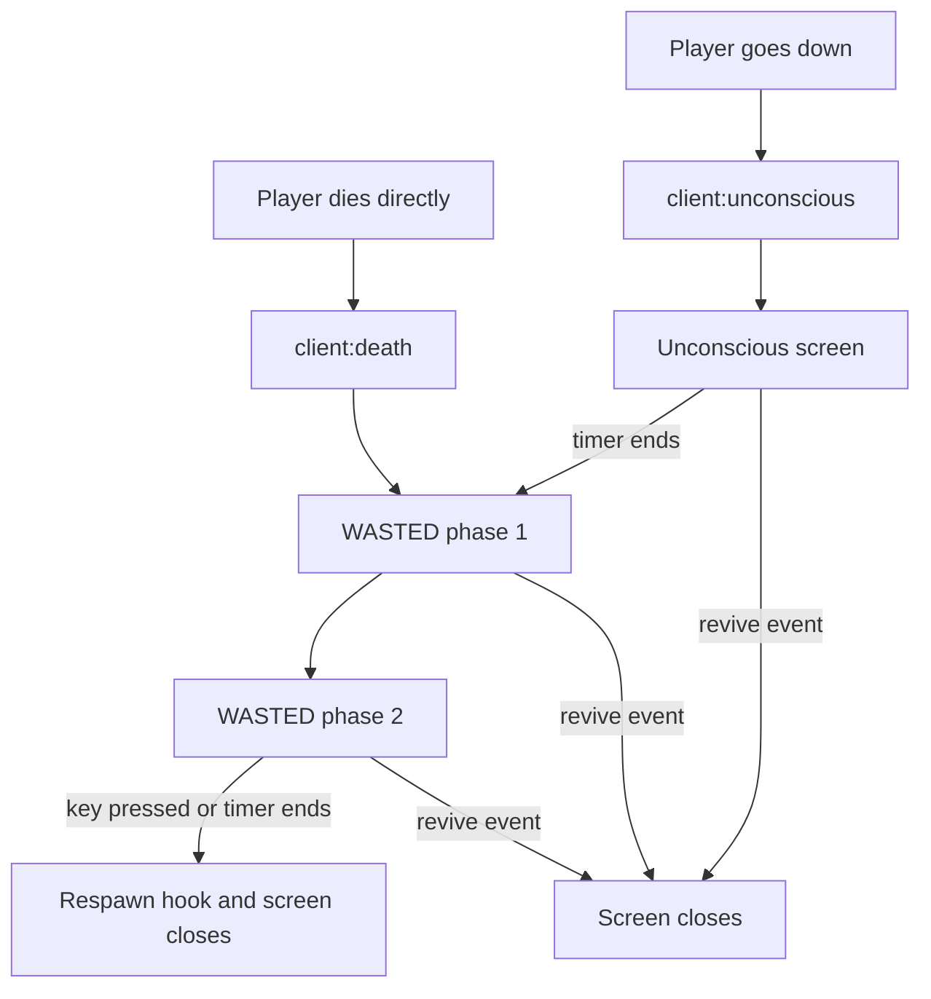

# Nexus DeathScreen

> Immersive unconscious and death screens with a live heart monitor, a death camera, a cause-of-death readout and a medic call system for ESX and QBCore.

**Version:** 2.2.0 · **Framework(s):** ESX, QBCore · **Database:** None

***

## Description

Nexus DeathScreen replaces the default downed and dead states of your server with a complete, fully styled interface. It does not decide when a player goes down or dies: your ambulance script keeps owning that logic and simply tells DeathScreen what to display through three client events (`unconscious`, `death` and `revive`).

When a player goes down, the **unconscious screen** appears with a countdown, an animated heart, a BPM counter and a live ECG line that speeds up, slows down and turns critical as the timer runs out. While it is visible the player can call for medics. When the timer ends, the resource switches by itself to the **WASTED screen**, starts the death camera and shows a cause of death generated from the weapon and the body zone that killed the player. The WASTED screen has two phases: a waiting phase where medics can still arrive, and a respawn phase where the player can respawn manually or is respawned automatically after a configurable time.

Every timing, key, camera behaviour, visual effect and cause-of-death phrase is editable, and every text is translated into seven languages.

***

## Features

* **Unconscious screen** with countdown, animated heart, BPM and ECG that react to the remaining time and switch to a critical state at the end.
* **WASTED screen in two phases**: a waiting phase while help can still arrive, followed by a respawn phase with a manual respawn key and an optional forced respawn timer.
* **Cause of death** built from the weapon category and the body zone that received the last damage, with a random generic phrase when the cause cannot be identified. More than 110 weapon hashes and 35 bones are mapped out of the box and you can extend both tables.
* **Damage capture** during the whole downed state, so the cause is correct even when the player is already in laststand and the game no longer reports a cause of death. On ESX the `deathCause` sent by `esx:onPlayerDeath` is used as an additional source.
* **Medic call system on both screens**, each one with its own key, maximum number of calls, cooldown, cooldown bar and remaining-call indicator. Counters reset every time the screen closes.
* **Death camera** with three modes: `orbit` (automatic rotation), `orbit_free` (mouse controlled rotation and scroll zoom with collision against walls) and `static` (fixed offset). Smooth blend in and out.
* **Visual effects**: `blackout`, `minimal` and `vignette`.
* **Optional control blocking** per state (`none`, `keyboard`, `mouse`, `keyboard+mouse`).
* **Street name** of the place where the player went down, shown on the unconscious screen.
* **Editable hooks** in `shared/functions.lua` to connect any ambulance, dispatch or hospital script.
* **7 languages**: `es`, `en`, `de`, `fr`, `it`, `pt`, `zh`, all of them editable and not encrypted.
* **Configurable keys** for respawn, unconscious help call and dead medic call.
* **No database** and no extra dependencies.

***

## Dependencies

### Required

* A supported framework selected in `Config.Framework`: ESX (`es_extended`) or QBCore (`qb-core`).
* An ambulance resource that triggers the DeathScreen events: `esx_ambulancejob` for ESX or `qb-ambulancejob` for QBCore, or any other script that handles downed players.

### Optional

* Any dispatch or medic-alert script. Connect it by editing the hooks `OnHelpKeyPressed` and `OnDeadHelpCallTriggered`.

### Server requirements

* No database, no SQL import and no extra libraries.
* The resource folder must be named exactly `nexus_deathscreen`. Any other name stops the resource with a console error.

***

## Installation

1. Drop the `nexus_deathscreen` folder into your `resources` directory. Keep the folder name exactly `nexus_deathscreen`.
2. Add `ensure nexus_deathscreen` to your `server.cfg`, **after** your framework and your ambulance resource.
3. Open `shared/config.lua` and set `Config.Framework` (`'esx'` or `'qb'`) and `Config.Locale`.
4. Make your ambulance script trigger the DeathScreen events (see **Integration examples** below).
5. Synchronise the timers with your ambulance script (see **Timers and ambulance synchronisation**).
6. Restart the server, or run `ensure nexus_deathscreen` from the console.

To check everything is working without dying, set `Config.Debug = true`, restart the resource and run `/deathtest unconscious` or `/deathtest dead` in game. Run `/deathhide` to close the screen.

***

## Configuration

Everything is configured in `shared/config.lua`. The file is not encrypted.

### General

| Option                | Default                                   | Description                                                                                              |
| --------------------- | ----------------------------------------- | -------------------------------------------------------------------------------------------------------- |
| `Config.Framework`    | `'esx'`                                   | `'esx'` or `'qb'`. Decides which framework events the hooks in `functions.lua` use.                      |
| `Config.Locale`       | `'en'`                                    | `es`, `en`, `de`, `fr`, `it`, `pt` or `zh`. If the language does not exist, Spanish is used.             |
| `Config.HelpKey`      | `'g'`                                     | Key that respawns the player on the WASTED screen once the respawn phase starts.                         |
| `Config.VisualEffect` | `'minimal'`                               | `'blackout'`, `'minimal'` or `'vignette'`.                                                               |
| `Config.Controls`     | `{ unconscious = 'none', dead = 'none' }` | Control blocking for each state. Accepted values: `'none'`, `'keyboard'`, `'mouse'`, `'keyboard+mouse'`. |
| `Config.Debug`        | `false`                                   | Registers the commands `/deathtest [dead\|unconscious]` and `/deathhide`.                                |

### Timers

All values are in seconds.

| Option                    | Default | Description                                                                                                                                                                             |
| ------------------------- | ------- | --------------------------------------------------------------------------------------------------------------------------------------------------------------------------------------- |
| `Config.UnconsciousTime`  | `15`    | Duration of the unconscious screen. When it ends, the WASTED screen opens automatically.                                                                                                |
| `Config.RespawnWaitTime`  | `15`    | Duration of the first WASTED phase, where the player can only wait or call for medics. Set it to `0` to skip this phase.                                                                |
| `Config.RespawnForceTime` | `30`    | Duration of the second WASTED phase. When it ends the player is respawned automatically. Set it to `0` to disable the forced respawn so the player always has to press the respawn key. |

#### Timers and ambulance synchronisation

The unconscious and death timers of DeathScreen should match the timers of the ambulance script, otherwise the player could be revived or marked as dead at a different moment than the one shown on screen.

* `Config.UnconsciousTime` should equal `Config.ReviveInterval` in `qb-ambulancejob/config.lua`.
* `Config.RespawnWaitTime` should equal `Config.DeathTime` in `qb-ambulancejob/config.lua`.
* `Config.RespawnForceTime` is exclusive to DeathScreen. Set it to the extra time you want before an automatic respawn.

On ESX, set the equivalent bleed-out and respawn timers of your `esx_ambulancejob` configuration to the same values.

### Medic calls

The unconscious and the dead screens have independent medic call settings.

```lua
Config.UnconsciousHelpCall = {
    enabled  = true,
    maxCalls = 3,
    cooldown = 20,
    key      = 'g',
}

Config.DeadHelpCall = {
    enabled  = true,
    maxCalls = 3,
    cooldown = 30,
    key      = 'h',
}
```

| Field      | Description                                                                                  |
| ---------- | -------------------------------------------------------------------------------------------- |
| `enabled`  | Turns the medic call on or off for that screen. When it is off the key does nothing.         |
| `maxCalls` | Maximum number of calls per screen. `0` means unlimited.                                     |
| `cooldown` | Seconds the player has to wait between two calls. A cooldown bar is displayed while it runs. |
| `key`      | Key name that triggers the call. See **Supported key names**.                                |

Every call runs the matching hook (`OnHelpKeyPressed` for the unconscious screen, `OnDeadHelpCallTriggered` for the dead screen). By default the hooks alert medics through `esx_ambulancejob:onPlayerDistress` on ESX and through `hospital:server:ambulanceAlert` on QBCore. The call counters and cooldowns reset whenever the screen closes, so a player who is revived and goes down again gets all their calls back.

### Death camera

```lua
Config.DeathCamera = {
    enabled = true,
    mode = 'orbit_free',
    blendInTime  = 1000,
    blendOutTime = 400,
    fov = 80.0,
    orbitRadius = 2.8,
    orbitHeight = 1.8,
    orbitSpeed  = 0.2,
    orbitMouseSens   = 7.0,
    orbitMinPitch    = -30.0,
    orbitMaxPitch    =  75.0,
    orbitMinRadius   =  1.2,
    orbitMaxRadius   =  6.0,
    orbitScrollSpeed =  0.3,
    offset = { x = 0.0, y = -2.5, z = 1.8 },
}
```

| Option                              | Default                          | Description                                                                           |
| ----------------------------------- | -------------------------------- | ------------------------------------------------------------------------------------- |
| `enabled`                           | `true`                           | Enables or disables the death camera. The camera starts when the WASTED screen opens. |
| `mode`                              | `'orbit_free'`                   | `'orbit'`, `'orbit_free'` or `'static'`.                                              |
| `blendInTime`                       | `1000`                           | Milliseconds of the transition into the camera.                                       |
| `blendOutTime`                      | `400`                            | Milliseconds of the transition back to the gameplay camera.                           |
| `fov`                               | `80.0`                           | Field of view in degrees.                                                             |
| `orbitRadius`                       | `2.8`                            | Initial distance to the player in meters (`orbit` and `orbit_free`).                  |
| `orbitHeight`                       | `1.8`                            | Initial height above the player in meters.                                            |
| `orbitSpeed`                        | `0.2`                            | Degrees rotated per frame in `orbit` mode.                                            |
| `orbitMouseSens`                    | `7.0`                            | Mouse sensitivity in `orbit_free` mode. Higher is faster.                             |
| `orbitMinPitch` / `orbitMaxPitch`   | `-30.0` / `75.0`                 | Lowest and highest vertical angle in degrees.                                         |
| `orbitMinRadius` / `orbitMaxRadius` | `1.2` / `6.0`                    | Closest and farthest zoom distance in meters.                                         |
| `orbitScrollSpeed`                  | `0.3`                            | Meters added or removed per mouse wheel step.                                         |
| `offset`                            | `{ x = 0.0, y = -2.5, z = 1.8 }` | Fixed camera position relative to the player in `static` mode.                        |

Camera modes:

* `orbit`: the camera circles the player automatically without any input.
* `orbit_free`: move the mouse to rotate around the player and change the height, and use the mouse wheel to zoom in and out. The camera always looks at the player and is pushed forward when a wall or object would block the view.
* `static`: the camera stays at the configured offset and looks at the player.

### Control blocking

`Config.Controls` blocks inputs while the screen is open, separately for the `unconscious` and `dead` states.

| Value              | Effect                                                                    |
| ------------------ | ------------------------------------------------------------------------- |
| `'none'`           | No input is blocked.                                                      |
| `'keyboard'`       | Blocks movement, jump, attack, cover, weapon wheel and vehicle exit keys. |
| `'mouse'`          | Blocks mouse look and the attack buttons.                                 |
| `'keyboard+mouse'` | Blocks both groups.                                                       |

The death camera in `orbit_free` mode keeps working when the mouse is blocked, because it reads the raw mouse movement.

### Supported key names

The three key options (`Config.HelpKey`, `Config.UnconsciousHelpCall.key` and `Config.DeadHelpCall.key`) accept these names, in upper or lower case:

* Letters `a` to `z`, except `i`, `j` and `o`.
* Digits `1` to `9`.
* Function keys `f1`, `f2`, `f3` and `f5` to `f11`.
* `space`, `enter`, `tab`, `backspace`, `caps`, `home`, `pageup`, `pagedown`, `delete`.
* `lshift` (or `leftshift`), `lctrl` (or `leftctrl`), `lalt` (or `leftalt`).
* Arrows: `up`, `down`, `left`, `right`.
* Symbols: `-`, `=`, `[`, `]`, `,`, `.` and `~`.

An invalid name prints a warning in the client console and falls back to the default: `G` for the respawn key and the unconscious help call, and `H` for the dead medic call. The key shown inside the on-screen hint always matches the configured key.

### Cause of death tables

`Config.DeathCauses` decides which category a weapon belongs to and which body zone a bone belongs to. The texts that are displayed live in the locale files.

```lua
Config.DeathCauses.Weapons = {
    [0x1B06D571] = 'pistol',
    [0xBFEFFF6D] = 'rifle',
}

Config.DeathCauses.Zones = {
    [31086] = 'head',
    [24818] = 'chest',
}
```

* **Weapons** maps a weapon hash to a category. Hashes can be written with or without sign, both forms are recognised.
* **Zones** maps a bone id to a body zone.
* Available weapon categories: `pistol`, `smg`, `rifle`, `sniper`, `shotgun`, `explosive`, `fire`, `fire_env`, `heavy`, `blade`, `blunt`, `fist`, `explosion`, `vehicle`, `fall`, `water` and `electric`.
* Available body zones: `head`, `neck`, `chest`, `abdomen`, `shoulder`, `arm`, `hand`, `hip`, `leg` and `foot`.

To add a weapon from an add-on pack, add its hash and one of the existing categories. To create a new category, add it in `Config.DeathCauses.Weapons` and also create the same category inside the `death` table of **every** locale file, with at least a `_default` phrase.

#### How the cause is resolved

1. From the moment the player is damaged, DeathScreen keeps the weapon and the bone of the last damage received.
2. When the death screen is about to open, it looks for the weapon category using, in order: the last captured weapon, the game cause of death and the `deathCause` reported by `esx:onPlayerDeath`.
3. If a category is found, the phrase for the captured body zone is shown. If that zone has no phrase in the category, the `_default` phrase of the category is used.
4. If no category is found, a random phrase from `death_fallback` is shown.

The captured data is cleared when the player respawns, is revived, or spawns again, so a previous death never leaks into the next one.

***

## Screens and flow



* **Unconscious screen** (`Config.UnconsciousTime`): shows the title, the street where the player went down, the countdown and the heart monitor. The unconscious medic call key is active.
* **WASTED phase 1** (`Config.RespawnWaitTime`): shows the cause of death and the message waiting for medical response. The dead medic call key is active. The respawn key does nothing yet.
* **WASTED phase 2** (`Config.RespawnForceTime`): the message changes to the respawn prompt, a forced respawn countdown is shown and the respawn key becomes active. The dead medic call key stays active.
* **Closing**: any screen closes immediately when `nexus_deathscreen:client:revive` is triggered, after a respawn, or after `nexus_deathscreen:client:doSpawn`.

The screen never takes mouse focus, so the player keeps full control of the keyboard unless you configure control blocking.

***

## Locales and editable strings

### Included languages

`es`, `en`, `de`, `fr`, `it`, `pt` and `zh`. The language is selected with `Config.Locale`. When a key is missing in the selected language, the Spanish text is used.

### Where the strings live

All texts are in `locales/<lang>.lua` and are not encrypted. Every file uses the same keys:

| Group                      | Keys                                                                                                                                                |
| -------------------------- | --------------------------------------------------------------------------------------------------------------------------------------------------- |
| Screen titles and messages | `unconscious_title`, `unconscious_wait`, `death_title`, `death_reason_default`, `phase1_msg`, `phase2_msg`, `phase2_hint`, `help_hint`, `help_sent` |
| Unconscious medic call     | `u_call_hint`, `u_call_sent`, `u_call_cooldown`, `u_call_no_calls`                                                                                  |
| Dead medic call            | `dead_call_hint`, `dead_call_sent`, `dead_call_cooldown`, `dead_call_no_calls`                                                                      |
| Labels                     | `critical`, `seconds_label`, `min_label`, `sec_label`                                                                                               |
| QBCore ambulance alerts    | `ambulance_alert_unconscious`, `ambulance_alert_dead`                                                                                               |
| Cause of death             | `death` (phrases by category and zone) and `death_fallback` (list of generic phrases)                                                               |

Placeholders must be kept: `%s` is replaced by the key name and `%d` by the remaining seconds.

### Adding a language

1. Copy `locales/en.lua` to `locales/<code>.lua`.
2. Change the first line to `Locales['<code>'] = {`.
3. Translate the values, keeping every key and every placeholder.
4. Set `Config.Locale = '<code>'`.

The `locales/*.lua` wildcard in the manifest loads the new file automatically.

***

## Compatibility

### Frameworks

| Framework | Ambulance resource | Notes                                                                                                                                                                                         |
| --------- | ------------------ | --------------------------------------------------------------------------------------------------------------------------------------------------------------------------------------------- |
| ESX       | `esx_ambulancejob` | Medic calls use `esx_ambulancejob:onPlayerDistress`. The respawn hook triggers `esx_ambulancejob:onRemoveItemsAfterRPDeath`.                                                                  |
| QBCore    | `qb-ambulancejob`  | Medic calls use `hospital:server:ambulanceAlert` with localized texts. The respawn is delegated to `hospital:client:RespawnAtHospital`, which picks the nearest hospital, a bed and the bill. |

Other ambulance resources work as long as they trigger the DeathScreen events and the hooks are adapted.

### Escrow

The following files are open and editable: `shared/config.lua`, `shared/functions.lua`, `locales.lua`, every file inside `locales/` and the NUI files inside `html/`. The client and server logic is encrypted.

***

## Developer API

### Exports

This resource does not expose exports. It is controlled through events and hooks.

### Events - Listened (client)

Trigger them from your ambulance script, on the client of the affected player.

| Event                                  | Parameters                            | Description                                                                                                                                                              |
| -------------------------------------- | ------------------------------------- | ------------------------------------------------------------------------------------------------------------------------------------------------------------------------ |
| `nexus_deathscreen:client:unconscious` | none                                  | Opens the unconscious screen at the current position. When `Config.UnconsciousTime` ends, the screen turns into the WASTED screen by itself.                             |
| `nexus_deathscreen:client:death`       | none                                  | Opens the WASTED screen directly, without the unconscious phase. If the WASTED screen is already open (for example after the automatic transition), the call is ignored. |
| `nexus_deathscreen:client:revive`      | none                                  | Closes any open screen, stops the camera and clears the captured damage data.                                                                                            |
| `nexus_deathscreen:client:doSpawn`     | `coords` table `{ x, y, z, heading }` | Resurrects the local player at the given coordinates with full health and closes the screen. `heading` is optional.                                                      |

```lua
TriggerEvent('nexus_deathscreen:client:unconscious')
TriggerEvent('nexus_deathscreen:client:death')
TriggerEvent('nexus_deathscreen:client:revive')

TriggerClientEvent('nexus_deathscreen:client:doSpawn', source, {
    x = 298.6, y = -584.4, z = 43.3, heading = 70.0,
})
```

### Events - Emitted

| Event                                         | Side          | Description                                                                                                                        |
| --------------------------------------------- | ------------- | ---------------------------------------------------------------------------------------------------------------------------------- |
| `nexus_deathscreen:client:onTransitionToDead` | client, local | Fired when the unconscious screen turns into the WASTED screen. Use it to synchronise the internal state of your ambulance script. |
| `nexus_deathscreen:server:onDeath`            | server        | Fired when the player is officially dead. Runs the `OnPlayerDeath` hook.                                                           |
| `nexus_deathscreen:server:doRespawn`          | server        | Fired by the client when it asks for a respawn (QBCore flow). Runs `DoServerRespawn`.                                              |

Both server events are sent from the client, so treat the `source` as a request and never use them to grant money, items or permissions.

```lua
AddEventHandler('nexus_deathscreen:client:onTransitionToDead', function()
    -- sync state
end)

AddEventHandler('nexus_deathscreen:server:onDeath', function()
    local src = source
    -- log death
end)
```

### Editable functions (`shared/functions.lua`)

The hooks are plain global functions that you can edit freely. The file also documents the timer synchronisation.

#### Client side

| Function                              | When it runs                                                                                                       | Default behaviour                                                                                                                        |
| ------------------------------------- | ------------------------------------------------------------------------------------------------------------------ | ---------------------------------------------------------------------------------------------------------------------------------------- |
| `OnHelpKeyPressed()`                  | The player uses the medic call on the **unconscious** screen.                                                      | ESX: triggers `esx_ambulancejob:onPlayerDistress`. QBCore: triggers `hospital:server:ambulanceAlert` with `ambulance_alert_unconscious`. |
| `OnDeadHelpCallTriggered(callNumber)` | The player uses the medic call on the **dead** screen. `callNumber` is the number of calls used so far.            | ESX: triggers `esx_ambulancejob:onPlayerDistress`. QBCore: triggers `hospital:server:ambulanceAlert` with `ambulance_alert_dead`.        |
| `OnRespawnTriggered(isForced)`        | The player respawns. `isForced` is `true` when the forced timer reached zero and `false` when the key was pressed. | ESX: triggers `esx_ambulancejob:onRemoveItemsAfterRPDeath`. QBCore: triggers `nexus_deathscreen:server:doRespawn`.                       |
| `OnRespawnDone()`                     | The screen has just been closed. Use it for cleanup.                                                               | Resets the local dead state on QBCore.                                                                                                   |

#### Server side

| Function                             | When it runs                             | Default behaviour                                                                     |
| ------------------------------------ | ---------------------------------------- | ------------------------------------------------------------------------------------- |
| `OnPlayerDeath(source)`              | The player is officially dead.           | Empty, the ambulance script keeps its own state.                                      |
| `OnPlayerRevived(source, revivedBy)` | A player is revived through DeathScreen. | QBCore: triggers `hospital:client:Revive` for the player.                             |
| `DoServerRespawn(source)`            | The client asked for a respawn.          | Calls `OnPlayerRevived` and, on QBCore, triggers `hospital:client:RespawnAtHospital`. |

### Integration examples

#### QBCore with qb-ambulancejob

Add these handlers in a client file of your ambulance script, or trigger the DeathScreen events directly from the places where the ambulance script starts and ends the downed state.

```lua
AddEventHandler('hospital:client:SetLaststand', function()
    TriggerEvent('nexus_deathscreen:client:unconscious')
end)

RegisterNetEvent('hospital:client:Revive', function()
    TriggerEvent('nexus_deathscreen:client:revive')
end)
```

#### ESX with esx\_ambulancejob

```lua
AddEventHandler('esx:onPlayerDeath', function()
    TriggerEvent('nexus_deathscreen:client:death')
end)

RegisterNetEvent('esx_ambulancejob:revive', function()
    TriggerEvent('nexus_deathscreen:client:revive')
end)
```

#### Third-party dispatch

Replace the default alert inside the hooks to send the call to your dispatch resource.

```lua
function OnHelpKeyPressed()
    local coords = GetEntityCoords(PlayerPedId())
    TriggerServerEvent('my_dispatch:server:medicAlert', coords, 'Unconscious player')
end

function OnDeadHelpCallTriggered(callNumber)
    local coords = GetEntityCoords(PlayerPedId())
    TriggerServerEvent('my_dispatch:server:medicAlert', coords, 'Dead player')
end
```

#### Custom respawn point

Skip the default respawn and send the player to your own location.

```lua
function OnRespawnTriggered(isForced)
    TriggerServerEvent('my_hospital:server:respawn', isForced)
end
```

The server script then moves the player and triggers `nexus_deathscreen:client:doSpawn` with the final coordinates, which resurrects the player and closes the screen.

#### Testing

With `Config.Debug = true`:

| Command                  | Description                                                                                                   |
| ------------------------ | ------------------------------------------------------------------------------------------------------------- |
| `/deathtest unconscious` | Opens the unconscious screen and continues to the WASTED screen when the timer ends.                          |
| `/deathtest dead`        | Opens the WASTED screen with the camera. The displayed cause is the real one when you took damage beforehand. |
| `/deathhide`             | Closes the screen and clears timers.                                                                          |

### Database schema

None.

***

## FAQ

**The screen does not appear when I go down.** Your ambulance script has to trigger `nexus_deathscreen:client:unconscious` or `nexus_deathscreen:client:death`. Check the integration examples and make sure `ensure nexus_deathscreen` is placed after the framework and the ambulance resource.

**The resource stops with an invalid resource name error.** The folder must be named `nexus_deathscreen`. Rename it and restart.

**My keys do nothing.** Use a name from the supported key list. Invalid names print a warning in the client console and use the default key.

**The respawn key does nothing at first.** The respawn key becomes active when the second WASTED phase starts. Lower `Config.RespawnWaitTime` or set it to `0` to enable it earlier.

**The screen text is in the wrong language.** Set `Config.Locale` to one of the included codes. If the code is not found, Spanish is used.

**The cause of death always shows a generic phrase.** The weapon is probably missing from `Config.DeathCauses.Weapons`. Add its hash with one of the existing categories.

**How do I add a weapon to the death causes?** Add its hash and a category in `Config.DeathCauses.Weapons`. A new category needs a `death` entry with `_default` in every locale file.

**Can I disable the death camera?** Yes, set `Config.DeathCamera.enabled = false`.

**Can I use the screens without the unconscious phase?** Yes. Trigger only `nexus_deathscreen:client:death` and the WASTED screen opens directly.

**Does it need a database?** No.
